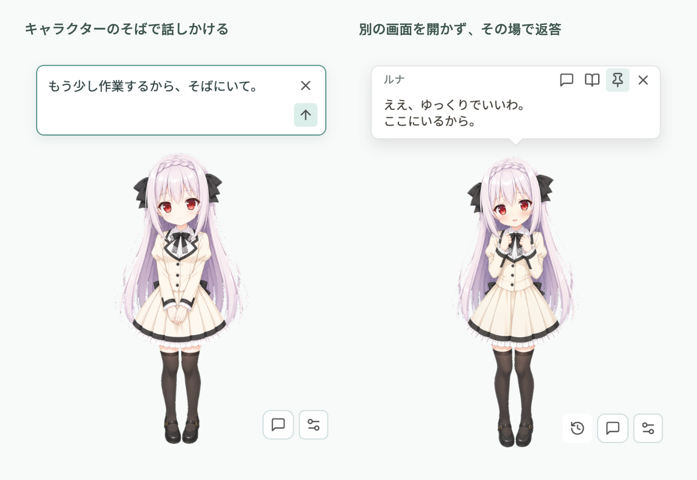

  <h1>Desktop Pet</h1>
  
<strong>好きなキャラクターと、デスクトップで。</strong>

  
Windows・macOS・Linux 対応のアニメ風デスクトップコンパニオン。 画像キャラクターや Live2D を選び、そばで会話できます。

  

    <a href="README.md">English</a> ·
    <a href="README.zh-CN.md">简体中文</a> ·
    <a href="README.ja.md">日本語</a>
  

  

    <a href="https://github.com/TonyNa-code/desktop-pet/releases/latest"><strong>ダウンロード</strong></a> ·
    <a href="#get-started">はじめる</a> ·
    <a href="docs/releases/v0.5.0.md">更新内容</a>
  

  

    
    
    
  

  <picture>
    <source media="(prefers-reduced-motion: reduce) and (prefers-color-scheme: dark)" srcset="docs/media/characters-dark.png">
    <source media="(prefers-reduced-motion: reduce)" srcset="docs/media/characters-light.png">
    <source media="(prefers-color-scheme: dark)" srcset="docs/media/characters-dark.gif">
    
  </picture>

**Default** と **Luna** の画像キャラクターを同梱しています。Default は動きのあるアクション、Luna は表情やポーズが中心です。上のプレビューは両パックの実際の素材を使用しています。

## いつものデスクトップに

- **好きな場所で。** ドラッグで移動し、75% から 200% までサイズを調整できます。常に手前に表示することもできます。
- **ふれると、表情が変わる。** 自動の反応か、一回のクリックで一つ進む手動モードを選べます。Live2D の待機動作と視線追従は個別に切り替えられます。
- **話しかけたいときは、その場で。** キャラクター横の入力欄から送信すると、返答は頭上の吹き出しに届きます。履歴を読みたいときはチャット画面を開けます。
- **性格や呼び方を自分で。** 名前、性格、話し方、あなたとの関係を設定できます。人物設定と会話はキャラクターごとに分かれています。
- **日々の小さな手助け。** 時刻の確認、集中・休憩リマインダー、位置の記憶に対応。見失ったペットはメニューバーやトレイから呼び戻せます。

<picture>
  <source media="(max-width: 600px)" srcset="docs/media/conversation-ja-mobile.png">
  
</picture>

現在のアプリ画面と会話例です。小さな画面では返答側のみを表示します。

## ダウンロード

**[最新リリース](https://github.com/TonyNa-code/desktop-pet/releases/latest)** から、お使いのシステムに合うファイルを選んでください。ペットだけならモデルの設定は不要です。会話や音声は後から追加できます。

| システム | ファイル |
| --- | --- |
| Windows x64 | インストーラー `win-x64-setup.exe`、または `win-x64-portable.exe` |
| macOS Apple Silicon | `mac-arm64.dmg`、または `mac-arm64.zip` |
| Linux x64 | `linux-x86_64.AppImage`、または `linux-x64.tar.gz` |

表はファイル名の末尾です。実際の名前にはアプリ名とバージョンも入ります。macOS 版は未署名です。起動方法は[クイックスタート](快速上手指南.md)（中国語）をご覧ください。Linux のトレイやウィンドウ配置はデスクトップ環境に依存し、Wayland では制限されることがあります。

## はじめる

1. **キャラクターを選ぶ。** 会話アイコン横のメニューから設定を開き、組み込みキャラクターか、追加したパックを選びます。
2. **人物設定を決める。** 名前、性格、話し方、友人・恋人などの関係を設定できます。初期設定のままでも使えます。
3. **会話サービスをつなぐ。** プロバイダーや互換ローカルサービスを選び、モデル名と接続情報を入力して、接続テストを行います。

表示言語はシステムに合わせるほか、日本語・英語・簡体字中国語から選べます。

### 自分の Live2D を追加

書き出した `.model3.json` と関連ファイル、または一つのモデルを含む ZIP を読み込みます。頭をなでる、そっと触れる、返答の感情に、モデルの表情やモーションを割り当てられます。まばたき、呼吸、視線追従、外部 TTS の音量による口の動きにも対応しています。

初回は対応する Cubism Core を端末に導入してください。Core とサンプルモデルは同梱されません。編集用の `.cmo3` や一枚のイラストは、そのままでは読み込めません。

**[Live2D の導入と互換性](docs/live2d.md#日本語)**

### 会話と音声を選ぶ

| 会話サービス | 任意の音声 |
| --- | --- |
| OpenAI Chat Completions 互換サービス。DeepSeek、OpenAI、Gemini、Qwen、SiliconFlow、OpenRouter、Groq などのプリセット | システム音声、ローカルの GPT-SoVITS 推論サービス、カスタム TTS API |
| Ollama、LM Studio などのローカルサービス | 推論サービスの URL で接続します。音声モデルの重みを直接読み込んだり学習したりする機能ではありません |

音声は初期状態でオフです。各サービスにはそれぞれの認証情報が必要です。Anthropic Messages、Gemini GenerateContent、OpenAI Responses のネイティブ API は Chat Completions とは異なります。[接続ガイド](docs/usage.ja.md#チャット人物設定音声)で入力項目とテスト方法を確認できます。

## データの保存を選べます

設定とキャラクターのプロフィールは端末内に保存します。API キーは利用可能なシステムの安全な保存機能で暗号化し、安全に永続化できない場合は起動中だけ保持します。

履歴保存、共通の記憶、実験的な好感度は **初期状態ではオフ** です。会話の文脈と有効にした記憶は設定先のモデルへ、読み上げる文章は選んだ TTS サービスへ送信されます。マイクの録音は行いません。[保存とプライバシーの詳細](docs/usage.ja.md)。

## ガイド

| ガイド | 内容 |
| --- | --- |
| [使い方](docs/usage.ja.md) | 会話、音声、記憶、ふれあい、位置の復元 |
| [Live2D](docs/live2d.md#日本語) | 導入、表情、モーションの設定と互換性 |
| [キャラクターの差し替え・制作](角色更换与制作指南.md)（中国語） | 画像パック、テンプレート、画像生成プロンプト |
| [ソースから実行・開発への参加](CONTRIBUTING.md) | セットアップ、チェック、プロジェクト構成 |

不具合は [Issue](https://github.com/TonyNa-code/desktop-pet/issues/new) へ。OS とアプリのバージョンを添え、認証情報や個人の会話履歴は含めないでください。

---

コード：[MIT](LICENSE)。画像：[素材について](ASSET_NOTICE.md)。フォント：[OFL 1.1](assets/fonts/NOTICE.md)。Live2D 関連：[サードパーティーのライセンス](src/live2d/vendor/NOTICE.md)。
