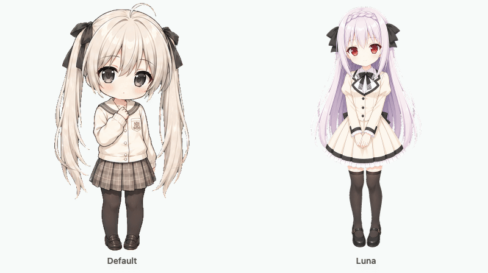
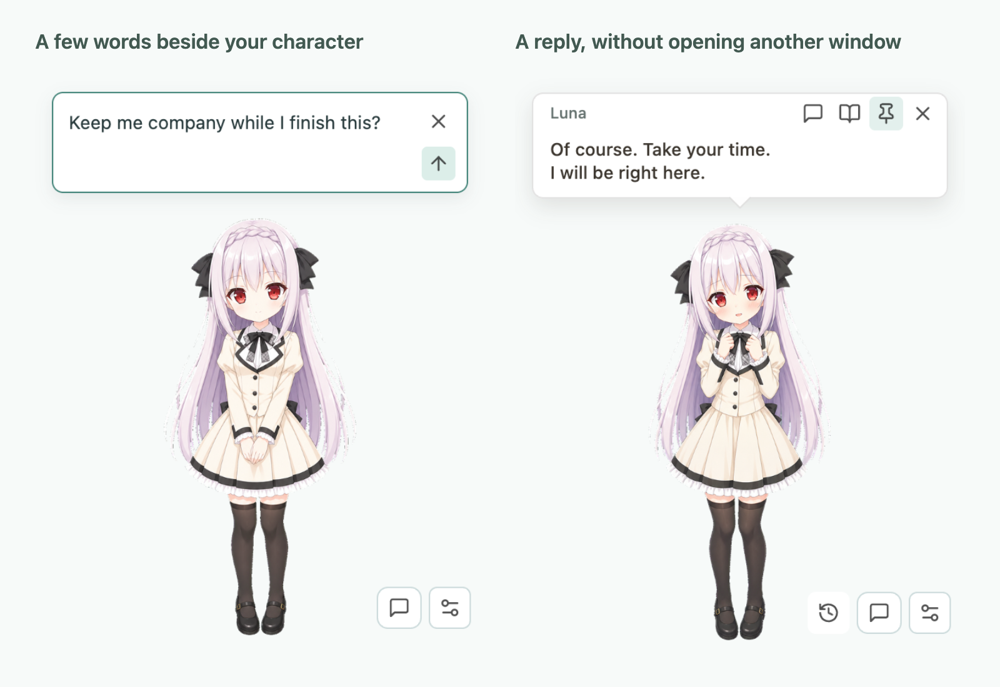

  <h1>Desktop Pet</h1>
  
<strong>A little company, right on your desktop.</strong>

  
An anime desktop companion for Windows, macOS and Linux. Sprite characters, optional Live2D, and conversations beside them.

  

    <a href="README.md">English</a> ·
    <a href="README.zh-CN.md">简体中文</a> ·
    <a href="README.ja.md">日本語</a>
  

  

    <a href="https://github.com/TonyNa-code/desktop-pet/releases/latest"><strong>Download</strong></a> ·
    <a href="#get-started">Get started</a> ·
    <a href="docs/releases/v0.5.0.md">What’s new</a>
  

  

    
    
    
  

  <picture>
    <source media="(prefers-reduced-motion: reduce) and (prefers-color-scheme: dark)" srcset="docs/media/characters-dark.png">
    <source media="(prefers-reduced-motion: reduce)" srcset="docs/media/characters-light.png">
    <source media="(prefers-color-scheme: dark)" srcset="docs/media/characters-dark.gif">
    
  </picture>

The two built-in packs are **Default**, with animated actions, and **Luna**, with expressive, mostly static poses. The preview above shows both packs' own artwork.

## At Your Side

- **A character that stays with you.** Drag them to a comfortable spot, choose a size from 75% to 200%, and keep them above your other windows.
- **A touch, an expression.** Choose automatic reactions or change one expression with each click. Quiet idle and gaze controls are available for Live2D.
- **A few words, right there.** Open the input beside the character. Replies appear above them; the full chat window is there when you want your conversation history.
- **Your character, your tone.** Set a name, personality, preferred form of address and relationship. Each character keeps a separate persona and conversation.
- **Small everyday extras.** Check the time, start a focus reminder, or set a break reminder. Position memory and tray controls help you find the pet again.

<picture>
  <source media="(max-width: 600px)" srcset="docs/media/conversation-en-mobile.png">
  
</picture>

Current app interface with example dialogue. On small screens, the reply view is shown on its own.

## Download

Open the **[latest release](https://github.com/TonyNa-code/desktop-pet/releases/latest)** and choose a file for your system. The sprite pet works on its own; chat and voice are optional.

| System | Choose |
| --- | --- |
| Windows x64 | `win-x64-setup.exe` to install, or `win-x64-portable.exe` to run without installation |
| macOS Apple Silicon | `mac-arm64.dmg`, or the `mac-arm64.zip` archive |
| Linux x64 | `linux-x86_64.AppImage`, or `linux-x64.tar.gz` |

These are filename endings; each download also includes the app name and version. macOS builds are unsigned. See the [startup guide](快速上手指南.md#macos) (Chinese) for first-launch help. Linux tray support and window positioning depend on the desktop environment, especially on Wayland.

## Make Yourself At Home

1. **Choose your character.** Open the menu beside the speech button, then Companion Settings. Keep a built-in character or import a character pack.
2. **Make them yours.** Set their name, personality and speaking style. Use a friend, partner or custom relationship, or leave the default persona in place.
3. **Connect a conversation service when ready.** Choose a provider or a compatible local server, fill in its model name and connection details, then use Test Chat Connection.

The interface follows your system language or switches to English, Simplified Chinese or Japanese.

### Bring Your Own Live2D

Import an exported `.model3.json` with its associated files, or a ZIP containing one model. Map its expressions and motions to head pats, gentle taps and reply moods. Blinking, breathing and optional gaze come from the model and renderer; external TTS audio can drive mouth opening.

Install the supported Cubism Core file locally first. Core and example models are not bundled. Editable `.cmo3` files and flat illustrations are not importable models.

**[Live2D setup and compatibility](docs/live2d.md)**

### Choose Chat And Voice

| Conversation | Optional voice |
| --- | --- |
| OpenAI Chat Completions-compatible services, including presets for DeepSeek, OpenAI, Gemini, Qwen, SiliconFlow, OpenRouter and Groq | System voices, a local GPT-SoVITS inference service, or a custom TTS API |
| Local endpoints such as Ollama and LM Studio | Connect an inference service by URL; the app does not load or train voice-model weights |

Voice is off by default. Each service uses its own credentials. Native Anthropic Messages, Gemini GenerateContent and OpenAI Responses are not the same protocol as Chat Completions. See the [connection guide](docs/usage.en.md#chat-persona-and-voice) for fields, tests and supported response formats.

## Your Data, Your Choices

Settings and character profiles stay on this device. API keys use system secure storage when available; without secure persistence, keys stay in memory for the current run.

Saved history, shared memories and experimental affection are **off by default**. Enabled memories and the conversation context you send are included in requests to your configured model service. Voice text goes to the TTS service you choose. The app does not record your microphone. [Storage and privacy details](docs/usage.en.md).

## Go Further

| Guide | What’s inside |
| --- | --- |
| [Using Desktop Pet](docs/usage.en.md) | Conversation, voices, memories, touch reactions and window recovery |
| [Live2D](docs/live2d.md) | Import, expressions, motion mapping and compatibility |
| [Character creation](角色更换与制作指南.md) (Chinese) | Sprite packs, templates and image-generation prompts |
| [Run from source and contribute](CONTRIBUTING.md) | Setup, checks and project structure |

Found a problem? [Open an issue](https://github.com/TonyNa-code/desktop-pet/issues/new). Include your operating system and app version, but leave out credentials and personal chat history.

---

Code: [MIT](LICENSE). Artwork: [asset notice](ASSET_NOTICE.md). Fonts: [OFL 1.1](assets/fonts/NOTICE.md). Live2D components: [third-party notices](src/live2d/vendor/NOTICE.md).
