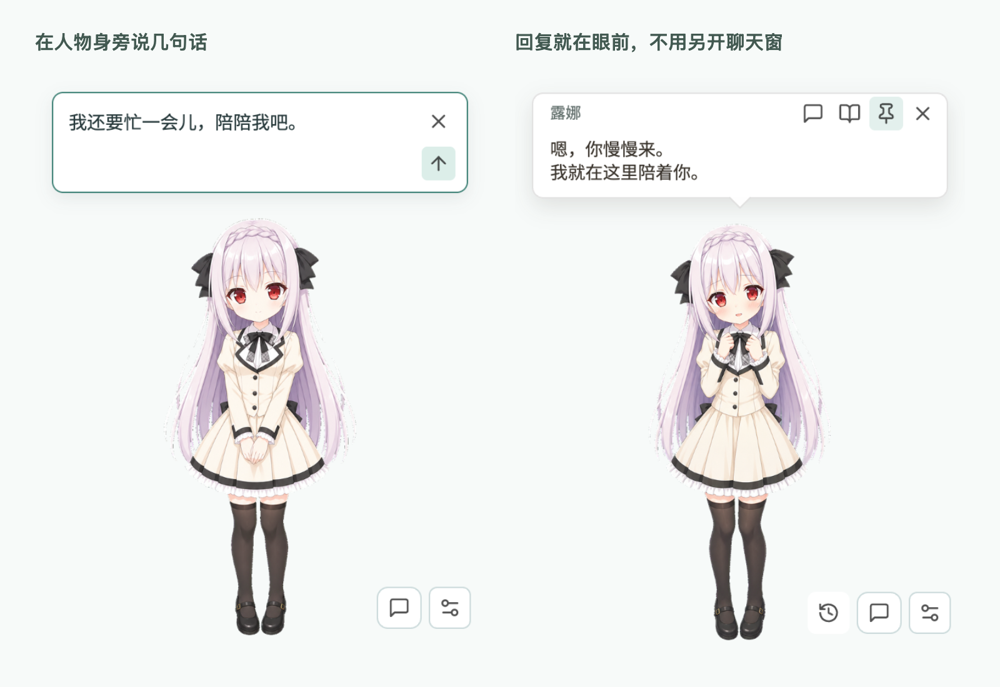

  <h1>Desktop Pet</h1>
  
<strong>把喜欢的角色，留在桌面上。</strong>

  
适用于 Windows、macOS 和 Linux 的二次元桌面陪伴工具。 图片桌宠、可选 Live2D，在人物身旁就能聊几句。

  

    <a href="README.md">English</a> ·
    <a href="README.zh-CN.md">简体中文</a> ·
    <a href="README.ja.md">日本語</a>
  

  

    <a href="https://github.com/TonyNa-code/desktop-pet/releases/latest"><strong>下载最新版</strong></a> ·
    <a href="#get-started">开始使用</a> ·
    <a href="docs/releases/v0.5.0.md">更新内容</a>
  

  

    
    
    
  

  <picture>
    <source media="(prefers-reduced-motion: reduce) and (prefers-color-scheme: dark)" srcset="docs/media/characters-dark.png">
    <source media="(prefers-reduced-motion: reduce)" srcset="docs/media/characters-light.png">
    <source media="(prefers-color-scheme: dark)" srcset="docs/media/characters-dark.gif">
    
  </picture>

内置 **Default** 和 **Luna** 两套图片角色：前者带有动态动作，后者以丰富的表情姿势为主。上方动图展示的是两套角色现有的素材。

## 在桌面上陪着你

- **放在喜欢的位置。** 拖动人物，调整到 75% 至 200% 的大小，也可以一直置顶。
- **摸摸头，换个表情。** 选择自动反应，或每点一次只换一个表情。Live2D 的待机动作和鼠标注视可以分别关闭。
- **想说话时，就在身旁。** 展开人物旁的小输入框，回复出现在人物上方。想翻聊天记录时，再打开完整聊天窗。
- **性格和称呼由你决定。** 填写人物性格、说话方式和希望被称呼的名字，选择朋友、恋人或自定义关系。每个角色分别保留人物设定和对话。
- **日常的小提醒。** 查看时间、开始专注或设置休息提醒。桌宠记得上次的位置，也能从菜单栏或系统托盘找回。

<picture>
  <source media="(max-width: 600px)" srcset="docs/media/conversation-zh-CN-mobile.png">
  
</picture>

当前版本界面，使用示例对话。小屏幕会单独展示回复画面。

## 下载

打开 **[最新发布页](https://github.com/TonyNa-code/desktop-pet/releases/latest)**，选择适合系统的文件。只使用桌宠不需要配置模型，聊天和语音可以之后再添加。

| 系统 | 选择文件 |
| --- | --- |
| Windows x64 | 安装版 `win-x64-setup.exe`，或免安装的 `win-x64-portable.exe` |
| macOS Apple Silicon | `mac-arm64.dmg`，或 `mac-arm64.zip` 压缩包 |
| Linux x64 | `linux-x86_64.AppImage`，或 `linux-x64.tar.gz` |

表格列出的是文件名后缀，下载文件前面还会带上应用名和版本号。macOS 版本未做商业签名，首次启动方法见[快速上手指南](快速上手指南.md)。Linux 的托盘和窗口定位受桌面环境影响，Wayland 下可能有限制。

## 开始你的陪伴

1. **先选一个角色。** 点对话图标旁的菜单，打开陪伴设置。可以使用内置角色，也可以导入角色包。
2. **填一点人物设定。** 设置名字、性格和说话方式，选择朋友、恋人或自定义关系；也可以先用默认设定。
3. **需要聊天时，再连接服务。** 选择模型平台或兼容的本地服务，填写模型名和连接信息，点“测试对话连接”确认。

界面可跟随系统语言，也可以切换简体中文、English、日本語。

### 导入你自己的 Live2D

选择导出的 `.model3.json` 及配套文件，或包含一个模型的 ZIP。可以把模型自带的表情、动作分配给摸摸头、轻碰和不同回复情绪；眨眼、呼吸、注视与外部 TTS 音量口型也能参与互动。

首次使用需在本机安装受支持的 Cubism Core 文件。安装包不附带 Core 或示例模型；编辑工程 `.cmo3` 和单张立绘不能直接作为模型导入。

**[Live2D 导入与兼容性指南](docs/live2d.md#简体中文)**

### 选择对话和声音

| 对话服务 | 可选语音 |
| --- | --- |
| 兼容 OpenAI Chat Completions 的服务，内置 DeepSeek、OpenAI、Gemini、千问、SiliconFlow、OpenRouter、Groq 等预设 | 系统语音、本地 GPT-SoVITS 推理服务或自定义 TTS API |
| Ollama、LM Studio 等本地服务 | 填写推理服务地址，应用不直接加载或训练语音模型权重 |

朗读默认关闭，每个平台使用各自的密钥。原生 Anthropic Messages、Gemini GenerateContent、OpenAI Responses 与 Chat Completions 并不是同一种接口。具体填法、连接测试和语音返回格式见[配置指南](docs/usage.zh-CN.md#对话人物设定与语音)。

## 数据由你选择保留

设置和人物档案保存在本机。API 密钥在可用时使用系统安全存储；无法安全持久化时，只在本次运行中保留。

保存聊天记录、共同记忆和实验性好感度均 **默认关闭**。聊天时，上下文和已启用的记忆会发给你配置的模型服务；朗读文本会发给所选 TTS 服务。应用不录制麦克风。[存储与隐私说明](docs/usage.zh-CN.md)。

## 继续了解

| 指南 | 内容 |
| --- | --- |
| [使用指南](docs/usage.zh-CN.md) | 对话、语音、记忆、触碰互动与窗口找回 |
| [Live2D 指南](docs/live2d.md#简体中文) | 导入、表情、动作映射和兼容范围 |
| [角色更换与制作](角色更换与制作指南.md) | 图片角色包、模板和生图提示词 |
| [源码运行与参与贡献](CONTRIBUTING.md) | 本地运行、检查与项目结构 |

遇到问题可以[提交 Issue](https://github.com/TonyNa-code/desktop-pet/issues/new)，附上系统和应用版本，勿附带密钥或私人聊天记录。

---

代码：[MIT](LICENSE)。角色图片：[素材说明](ASSET_NOTICE.md)。字体：[OFL 1.1](assets/fonts/NOTICE.md)。Live2D 组件：[第三方说明](src/live2d/vendor/NOTICE.md)。
